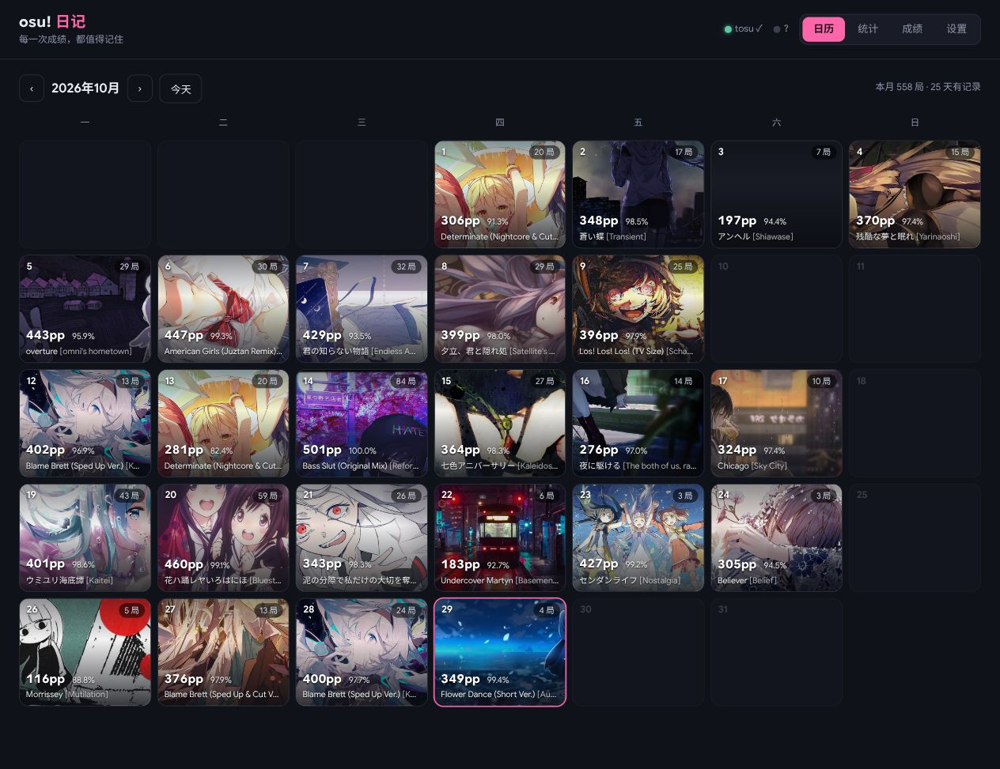
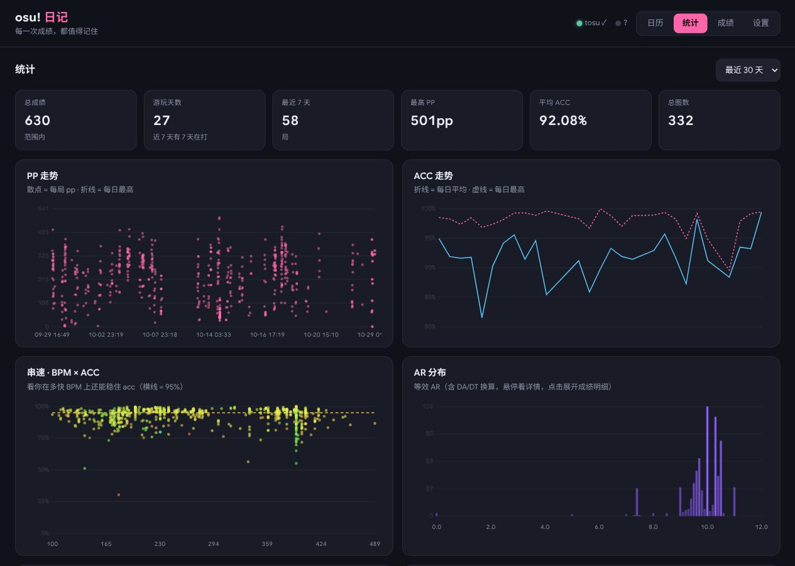
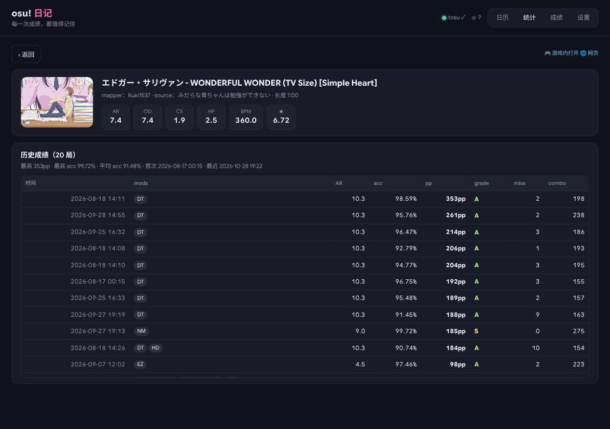

# osu-diary

**Every play, remembered.** A personal osu!lazer score diary for Linux.

[简体中文](README.zh-CN.md) · [Download](https://github.com/Roroca-1/osu-diary/releases/latest) · [User guide](docs/usage.md)



Your month at a glance. Revisit each day’s best play, then open a date to explore the whole session.

## Install in one line

```fish
curl -fsSL https://raw.githubusercontent.com/Roroca-1/osu-diary/main/install.sh | bash
```

Open [your dashboard](http://127.0.0.1:24051), launch osu!lazer, and play. Node.js and tosu are included—no development tools needed.

**Linux x86-64 · glibc 2.38+** · Tested on Ubuntu 24.04, Fedora and Arch. Ubuntu 22.04, Windows, ARM and Alpine are currently unsupported. The installer explains any required memory-access permission.

## See your progress

Track pp and accuracy over time. Explore how BPM, AR and mods shape your sessions, and filter the charts by date range.



## Revisit every attempt

Compare past scores on a beatmap, inspect its difficulty, and jump back into the game. Search your library by map, mods or minimum pp.



Automatically record new plays or import your existing lazer history. Scores stay on your computer; export them whenever you like.

*Screenshots show a real diary. The dashboard currently uses Chinese.*

[Setup & troubleshooting](docs/usage.md) · [Contributing](CONTRIBUTING.md) · [MIT license](LICENSE) · [Third-party notices](THIRD_PARTY_NOTICES.md)
