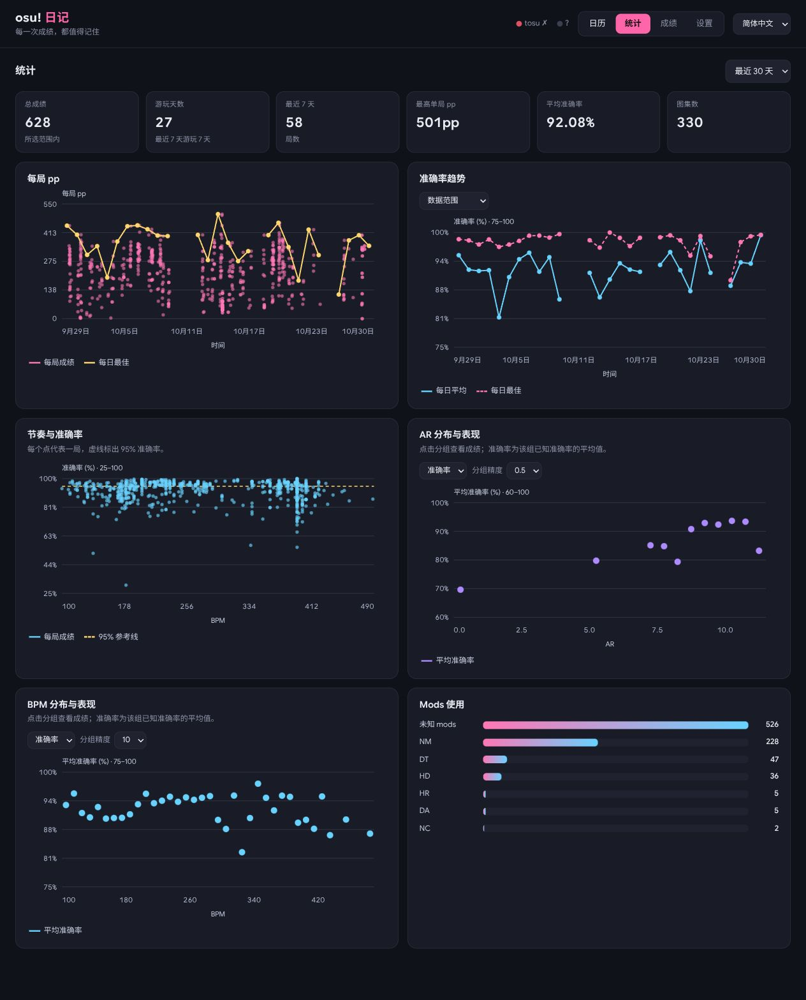
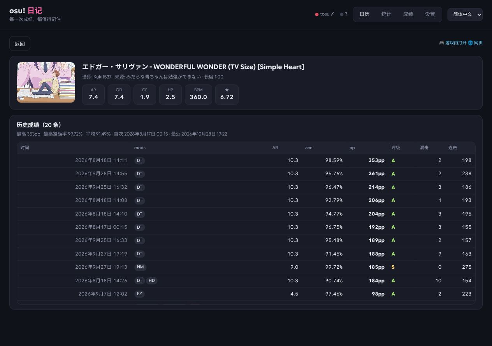

# osu-diary · osu! 日记

**每一次成绩，都值得记住。** 为 Linux 上的 osu!lazer 玩家打造的个人成绩日记。

[English](README.md) · [下载安装](https://github.com/Roroca-1/osu-diary/releases/latest) · [使用指南](docs/usage.zh-CN.md)


用一张日历回顾整个月。每天的最佳成绩一目了然，点击日期即可重温当天的全部游玩记录。

## 一行安装

```fish
curl -fsSL https://raw.githubusercontent.com/Roroca-1/osu-diary/main/install.sh | bash
```

打开[网页看板](http://127.0.0.1:24051)，启动 osu!lazer，照常游玩即可。安装包自带 Node.js 和 tosu，无需开发工具。

**Linux x86-64 · glibc 2.38+** · 已测试 Ubuntu 24.04、Fedora、Arch。暂不支持 Ubuntu 22.04、Windows、ARM 和 Alpine。需要内存读取权限时，安装器会说明并征求同意。

## 看见自己的进步

回顾每局 pp 与每日准确率。AR、BPM 图表可切换局数和平均准确率；点击分组，查看对应成绩。



## 重温每一次尝试

在谱面页对比历次成绩、查看难度信息，或一键回到游戏。支持按图名、mods、最低 pp 搜索成绩。



自动记录新成绩，也能导入已有的 lazer 历史。成绩保存在自己的电脑上，随时可以导出。

随时切换 **English / 简体中文**。语言偏好会自动记住，筛选条件和未保存的设置也会保留。

*截图来自真实日记。*

[安装与排错](docs/usage.zh-CN.md) · [参与开发](CONTRIBUTING.md) · [MIT 许可证](LICENSE) · [第三方声明](THIRD_PARTY_NOTICES.md)
